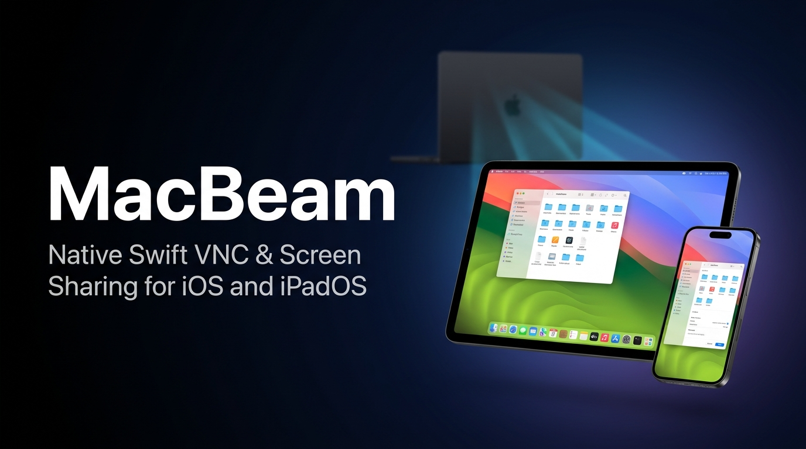

<p align="center">
  
</p>

<p align="center">
  
  
  
  
</p>

**MacBeam** is a 100% native Swift **iOS & iPadOS** VNC client purpose-built for viewing and controlling your Macs via **macOS Screen Sharing** and standard **RFB / VNC** servers — with **zero third-party dependencies**.

---

## Highlights

- **Native Swift RFB / VNC Protocol Engine (RFC 6143 + Apple Screen Sharing)**
  - Supports RFB **3.3, 3.7, 3.8**, and macOS Screen Sharing **3.889** over Apple's `Network.framework` (`NWConnection` with `TCP_NODELAY`).
  - **Apple Diffie-Hellman (Security Type 30)** for signing in directly with your macOS username & password (pure-Swift Montgomery `BigUInt`, `CryptoKit` MD5, and `CommonCrypto` AES-128-ECB) with strict parameter validation.
  - **Standard VNC Password (Security Type 2)** (DES-ECB with RFC 6143 bit-reversed keys) and **No Auth (Type 1)**, with explicit per-profile authentication pinning to prevent silent downgrades.
  - High-efficiency encodings: **ZRLE**, stateful streaming **Zlib** (`libz`), **CopyRect**, **Hextile**, **RRE**, and **Raw**, plus **DesktopSize**, **ExtendedDesktopSize**, **Rich Cursor**, **LastRect**, **Bell**, and **Clipboard Sync**.
  - All socket I/O, cryptography, zlib decompression, and framebuffer decoding run completely off the main thread.
- **Automatic Nearby Mac Discovery**
  - Scans `_rfb._tcp` over Bonjour (`NWBrowser`) so Macs with Screen Sharing enabled appear automatically and reconnect reliably by Bonjour service identity.
- **Native iOS & iPadOS Experience (Apple HIG Aligned)**
  - Adaptive saved-Mac card grid with last-seen screen preview thumbnails, `.searchable` filtering, Keychain-encrypted credential storage (`kSecAttrAccessibleWhenUnlockedThisDeviceOnly`), and confirmation dialogs for destructive actions.
  - **Trackpad Mode** & **Direct Touch Mode**, negotiated server cursor rendering, pinch-to-zoom, and automatic software keyboard avoidance.
  - Full **iPadOS Magic Keyboard & Trackpad / Mouse** support: hardware shortcut chords (with stuck-key prevention), pointer hover, primary click-drag, secondary right-click, smooth indirect scrolling, `.hoverEffect`, and keyboard shortcuts (`⌘N`, `⌘K`, `⌘R`, `⌘?`).
  - Collapsible dark-chrome glassmorphic HUD with 44pt touch targets, VoiceOver / Dynamic Type / Reduce Motion support, and a Mac modifier & shortcuts bar (`⌘`, `⌥`, `⌃`, `⇧`, `Esc`, `Tab`, arrows, `⌘Space`, `⌘Tab`, `⌘C`, `⌘V`, Force Quit, Mission Control).
  - Built-in **Demo Mac** loopback RFB 3.8 server so you can test live remote streaming immediately in Simulator or on device.

---

## Gestures & Controls

| Action | Trackpad Mode | Direct Touch Mode | iPad Hardware Mouse / Trackpad |
| --- | --- | --- | --- |
| Move Cursor | Drag anywhere | Tap destination | Hover pointer |
| Left Click | Single tap | Tap target | Primary click |
| Double Click | Double tap | Double tap target | Double primary click |
| Right Click | Two-finger tap | Long-press | Secondary click |
| Drag & Drop | Touch & hold, then drag | Drag (at 1× fit) | Primary click & drag |
| Scroll macOS | Two-finger drag | Two-finger drag | Two-finger scroll / wheel |
| Zoom Screen | Pinch | Pinch | Pinch |

---

## Project Structure

```text
MacBeam/
├── App/
│   └── MacBeamApp.swift               # App entry point
├── RFB/
│   ├── RFBTypes.swift                 # RFB versions, encodings, pixel formats, X11 keysyms
│   ├── RFBCrypto.swift                # Montgomery BigUInt, Apple DH (Type 30), VNC DES (Type 2)
│   ├── RFBZlibInflater.swift          # Persistent heap-pinned streaming zlib inflater/deflater
│   ├── RFBFramebuffer.swift           # 32-bpp BGRA framebuffer, ZRLE/CopyRect/Raw + CGImage
│   ├── RFBTransport.swift             # Cancellation-safe Network.framework TCP transport
│   ├── RFBClient.swift                # Off-MainActor RFB session worker + FIFO writer queue
│   ├── BonjourDiscovery.swift         # _rfb._tcp NWBrowser discovery
│   └── DemoMacServer.swift            # Loopback RFC 6143 VNC server for instant testing
├── Models/
│   ├── MacConnectionProfile.swift     # Connection profiles, auth policies, Bonjour endpoints
│   ├── KeychainStore.swift            # Atomic Keychain credential storage
│   └── ConnectionLibraryStore.swift   # Profile & thumbnail persistence
├── Views/
│   ├── HomeView.swift                 # Adaptive iOS/iPadOS connection dashboard
│   ├── RemoteSessionView.swift        # Immersive session HUD, shortcuts bar & sheets
│   ├── RemoteDisplayView.swift        # UIKit CALayer canvas, gestures, cursor & keyboard
│   ├── ConnectionEditorSheet.swift    # Add / edit Mac form
│   └── SetupGuideSheet.swift          # 3-step macOS Screen Sharing & gesture guide
└── Resources/
    ├── Info.plist                     # Local network, Bonjour (_rfb._tcp), indirect input
    └── Assets.xcassets/               # Light, Dark & Tinted AppIcon + adaptive colors
MacBeamTests/
└── RFBProtocolTests.swift             # Crypto vectors, bounds/fuzz checks & live RFB tests
```

---

## Getting Started

1. **Enable Screen Sharing on your Mac**
   - Open **System Settings → General → Sharing** and turn on **Screen Sharing**.
   - *(Optional)* Click the **ⓘ** button next to Screen Sharing if you prefer a dedicated VNC password instead of your macOS account login.
   - For remote access away from home Wi-Fi, connect over **Tailscale**, **WireGuard**, or an **SSH tunnel**.
2. **Open & Build in Xcode**
   - Open `MacBeam.xcodeproj` in Xcode (or regenerate it anytime via `xcodegen generate` from `project.yml`).
   - Choose an iPhone or iPad simulator (or select your Apple Development Team under **Signing & Capabilities** for a physical device).
   - Press **`⌘R`** to run or **`⌘U`** to run the unit & loopback RFB integration test suite.
